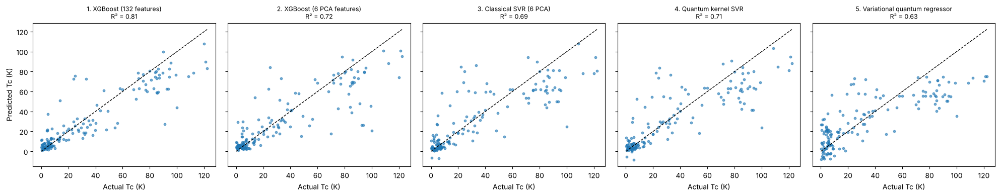
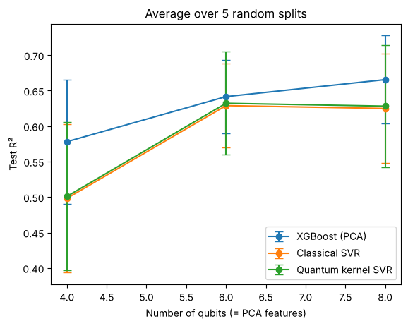
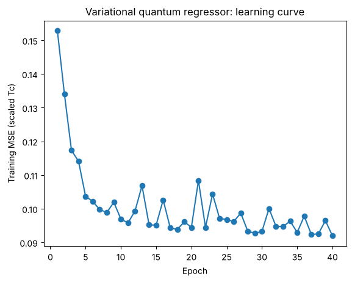

# Quantum Machine Learning for Superconductor Tc Prediction

Predicting the critical temperature (Tc) of superconductors with **quantum machine learning**, benchmarked fairly against classical models, including the XGBoost model from my undergraduate project.

The quantum circuits are built with [PennyLane](https://pennylane.ai/) and run on a classical simulator.

## Background

In my undergraduate project, I trained an XGBoost model on the SuperCon dataset (21,263 superconductors) using 132 Magpie compositional features generated with [matminer](https://hackingmaterials.lbl.gov/matminer/). This repository asks a follow-up question:

> **Can quantum machine learning models predict Tc as well as classical models, given the same data?**

## Models compared

| # | Model | Type | Input features |
|---|---|---|---|
| 1 | XGBoost (undergraduate project settings) | Classical | All 132 Magpie features |
| 2 | XGBoost | Classical | 6 PCA components |
| 3 | Support Vector Regression, RBF kernel | Classical | 6 PCA components |
| 4 | **Quantum kernel SVR** | Quantum (hybrid) | 6 PCA components |
| 5 | **Variational quantum regressor** | Quantum (hybrid) | 6 PCA components |

- **Quantum kernel SVR:** each material is encoded into a quantum state using an entangling feature map. The similarity between two materials is the overlap of their states, |⟨ψ(x)|ψ(x′)⟩|². A classical SVR then uses these similarities.
- **Variational quantum regressor:** a parameterized circuit (angle embedding with data re-uploading, plus strongly entangling layers) trained with the Adam optimizer, much like a small neural network.

### Why only 6 features and 600 materials?
Simulating *n* qubits takes 2ⁿ numbers, so the cost doubles with every qubit. Here one feature is encoded on one qubit, so the 132 Magpie features are compressed with PCA to match the number of qubits. A random subset of 600 materials (450 train / 150 test) keeps the simulation fast.

## Workflow

1. Load the Magpie-featurized SuperCon data
2. Random subset and train/test split
3. Standardize → PCA → rescale to rotation angles in [0, π] (fitted on training data only)
4. Train the classical baselines
5. Train the quantum kernel SVR
6. Train the variational quantum regressor
7. Compare all five models on the held-out test set
8. Repeat across 5 random splits and 4, 6 and 8 qubits, with a paired significance test

## Results

### Single split (6 qubits, seed 42)

| Model | Test R² | RMSE (K) |
|---|---|---|
| XGBoost (132 features) | **0.807** | 15.43 |
| XGBoost (6 PCA) | 0.719 | 18.62 |
| Classical SVR (6 PCA) | 0.690 | 19.56 |
| Quantum kernel SVR (6 PCA) | 0.710 | 18.92 |
| Variational quantum regressor (6 PCA) | 0.628 | 21.44 |



### Averaged over 5 random splits (mean ± std of test R²)

| Qubits | PCA info kept | XGBoost (PCA) | Classical SVR | Quantum kernel SVR | Quantum wins |
|---|---|---|---|---|---|
| 4 | 57.5% | 0.578 ± 0.087 | 0.498 ± 0.105 | 0.501 ± 0.104 | 3 / 5 |
| 6 | 67.6% | 0.642 ± 0.052 | 0.629 ± 0.059 | 0.632 ± 0.073 | 3 / 5 |
| 8 | 74.2% | 0.665 ± 0.062 | 0.625 ± 0.077 | 0.628 ± 0.086 | 3 / 5 |

**Paired t-test (quantum kernel vs classical SVR, all 15 splits):** mean ΔR² = +0.003, t = 0.87, p = 0.40 → no significant difference.



## Key findings

1. **The quantum kernel performed indistinguishably from the classical RBF kernel.** Across 15 paired splits (4, 6 and 8 qubits × 5 seeds), the mean difference was +0.003 R², far smaller than the split-to-split variation of ±0.06–0.10. The quantum kernel was better in 9 of 15 splits, and a paired t-test found no significant difference (t = 0.87, p = 0.40). The apparent advantage on the single split (0.710 vs 0.690) came from which materials happened to be in the test set.
2. **Information lost in PCA compression is the main bottleneck.** Six components keep only about 68% of the variance in the Magpie features. Compression alone drops XGBoost from R² 0.807 to 0.719.
3. **The variational model underfits.** Its training loss barely decreased, and its predictions are compressed toward the mean. Trainability problems like this (for example, barren plateaus) are a known challenge for variational quantum circuits.

   
4. **All models struggle with high-Tc materials (above about 60 K)** and under-predict the highest Tc values.

These results agree with the broader observation that quantum kernels tend to match, rather than beat, well-chosen classical kernels on classical tabular data.

## How to run

1. Open `Quantum_ML_SuperCon_Tc.ipynb` in [Google Colab](https://colab.research.google.com/) or Jupyter.
2. Generate `featurized_data.csv` with the featurization code in [`featurize.py`](featurize.py) (requires the SuperCon data, see below), or use your own copy.
3. Upload `featurized_data.csv` next to the notebook and run all cells.

```bash
pip install -r requirements.txt
```

## Data

The SuperCon dataset was compiled by Hamidieh (2018) and is available from the [UCI Machine Learning Repository](https://archive.ics.uci.edu/dataset/464/superconductivty+data). The data files are not included in this repository; download them from the source.

> K. Hamidieh, "A data-driven statistical model for predicting the critical temperature of a superconductor," *Computational Materials Science* **154**, 346–354 (2018).

## Possible next steps

- Tune the quantum kernel's bandwidth (scale the input angles) to counter kernel concentration at higher qubit counts
- Tune hyperparameters for both kernels on equal terms
- Use feature selection by XGBoost importance instead of PCA
- Reframe as classification (Tc above or below 77 K)
- Add simulated hardware noise

## Tools

Python · PennyLane · scikit-learn · XGBoost · matminer · pandas · NumPy · Matplotlib
